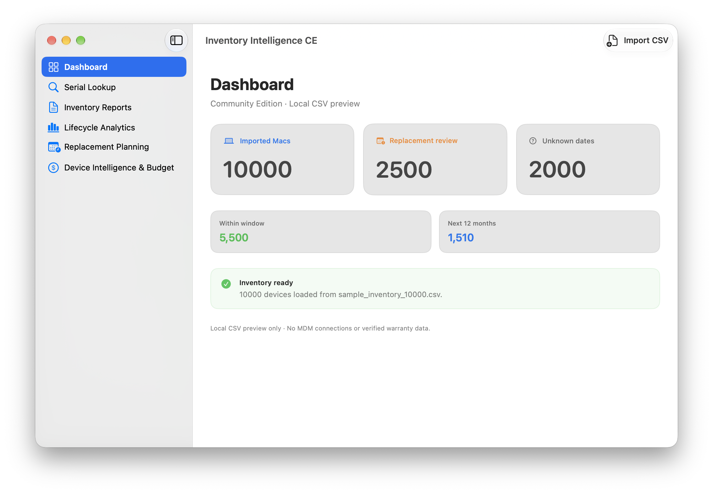
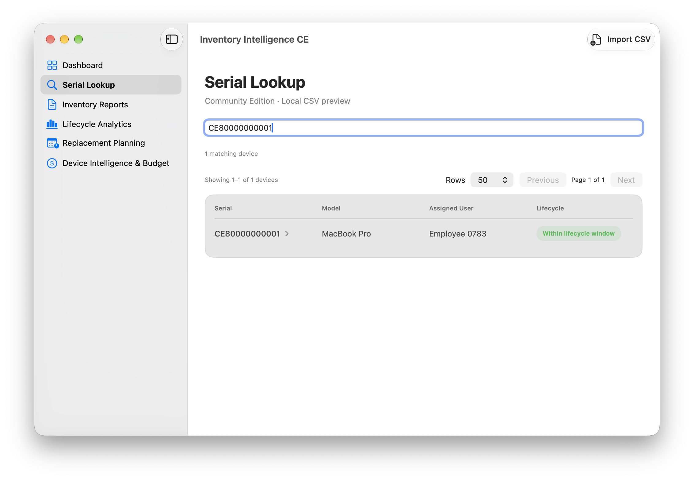
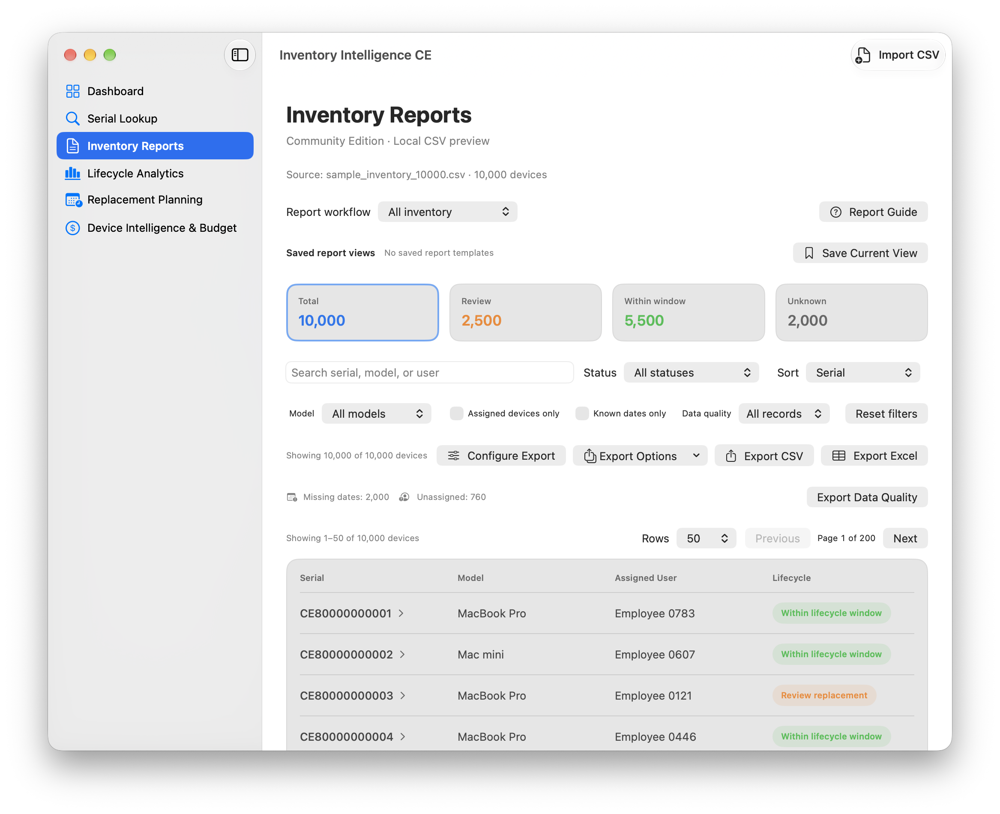
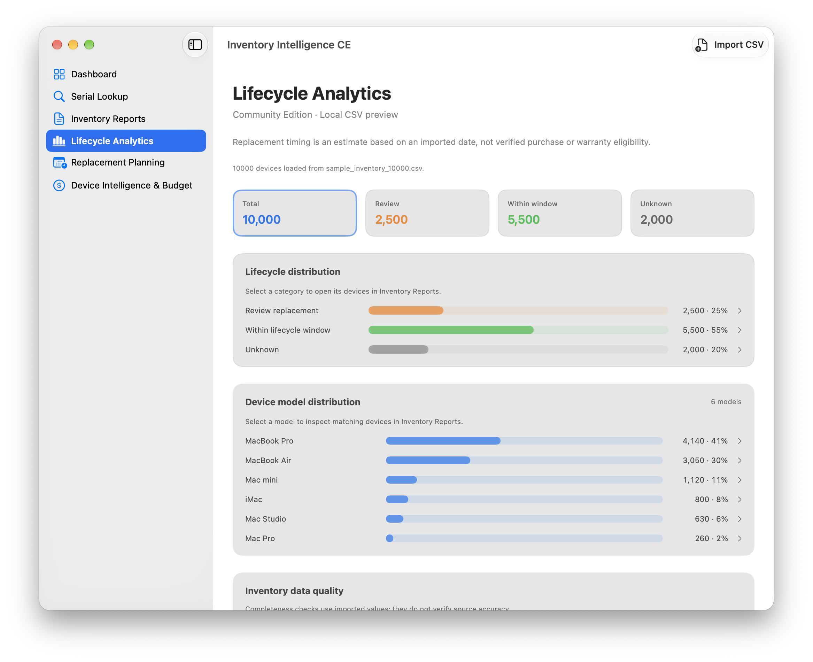
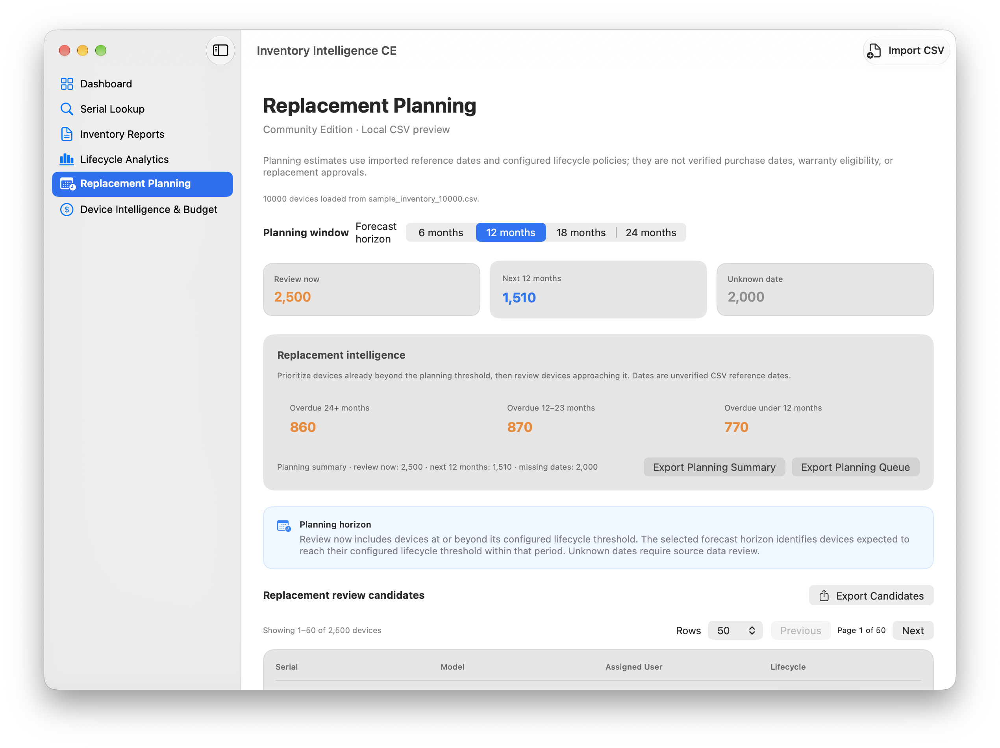
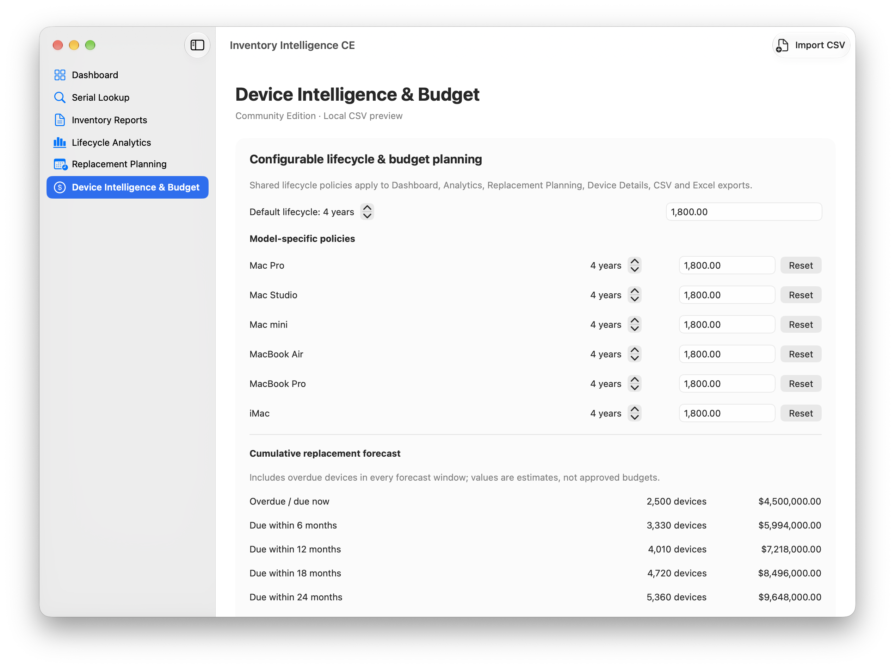

# Inventory Intelligence CE

**Understand your inventory. Plan what's next.**

A native macOS inventory analytics and device lifecycle planning application, built with SwiftUI.

   

Inventory Intelligence CE turns locally imported device inventory into lifecycle insights, replacement queues, and budget forecasts. **CE uses CSV files only**; it does not connect to Apple Business Manager, Jamf Pro, Intune, or other MDM services.

## Releases and development

| Edition | Version | Status |
| --- | --- | --- |
| Inventory Intelligence CE | **1.0.0** | Source release candidate; based on approved Stage 8 Increment 8 |
| Inventory Intelligence Organization/Enterprise | **7.0.1** | Separate, frozen internal enterprise baseline; not included here |

## Take a look

Inventory Intelligence CE uses a native macOS sidebar, consistent cards, status badges, searchable tables, and lifecycle planning views.

| Dashboard | Serial Lookup |
| :---: | :---: |
|  |  |

| Inventory Reports | Lifecycle Analytics |
| :---: | :---: |
|  |  |

| Replacement Planning | Device Intelligence & Budget |
| :---: | :---: |
|  |  |

## What it does

- **Dashboard** — See fleet totals, lifecycle health, unknown dates, and upcoming replacement needs.
- **Serial Lookup** — Find a device from its imported serial number and inspect its details.
- **Inventory Reports** — Search, filter, paginate, and export inventory records.
- **Lifecycle Analytics** — Analyze age, device models, data completeness, and upcoming replacement windows.
- **Replacement Planning** — Prioritize overdue devices and build replacement-review queues.
- **Device Intelligence & Budget** — Configure model-based lifecycle and cost policies, then forecast replacement spending over 6, 12, 18, and 24 months.
- **Native menus and Help** — Use **File → Import Inventory CSV…**, **File → Export**, and **Help → Inventory Intelligence Help**.

## Community vs. Enterprise

| Capability | Community Edition 1.0.0 RC1 | Enterprise Edition |
| --- | --- | --- |
| Inventory source | Local CSV import | Apple Business Manager and Jamf Pro integration |
| Dashboard, serial lookup, and inventory reporting | Included | Included |
| Lifecycle analytics | Included | Existing analytics; enhancements proposed for 7.1.0 |
| Configurable model-specific lifecycle policies | Included | Proposed for 7.1.0 |
| Replacement Planning tab | Included | Proposed for 7.1.0 |
| Replacement budget forecasting | Included | Proposed for 7.1.0 |
| Enhanced Device Intelligence | Included | Proposed for 7.1.0 |

Enterprise 7.0.1 is the separate, frozen Enterprise baseline. **The proposed 7.1.0 features are not yet released.** CE does not include Enterprise integration code or credentials.

## Get started

**Requirements:** Apple Silicon Mac, macOS 14+, and Xcode Command Line Tools with the macOS SDK.

1. Download or clone this source repository.
2. From the repository directory, build the application:

   ```bash
   zsh scripts/build_on_mac.zsh
   ```
3. Open the resulting application:

   ```bash
   open "dist/Inventory Intelligence CE.app"
   ```
4. Select **File → Import Inventory CSV…** and choose a CSV file.

The local build is **unsigned and not notarized**. The application icon is generated from `Assets/AppIcon.iconset` during the macOS build.

### CSV data

At minimum, provide `Serial` and `Model`. Recommended fields include `Assigned User` and `Date Added` (`YYYY-MM-DD`). See the [Help guide](Docs/HELP.md) for details.

Synthetic samples are included (`sample_inventory_1000.csv`, `sample_inventory_5000.csv`, `sample_inventory_10000.csv`). A 5,000-device dataset was used for visual and numerical review; the 10,000-device performance benchmark and final export reconciliation remain unconfirmed.

## Make it yours

The application display name is **Inventory Intelligence CE**. The app icon is the same artwork used by the separate Enterprise 7.0.1 package, supplied here as an iconset and 512px preview. The source release does not contain Enterprise integration code, credentials, or a live ABM/MDM connector.

## Privacy and data handling

CE analyzes **CSV files you choose locally**. It does not authenticate to ABM or an MDM and does not synchronize inventory from those platforms. Imported CSV files may contain personal or device-identifying information; review files before sharing them, and use synthetic data for public examples.

## Help and contributing

- [User guide](Docs/HELP.md)
- [Release notes](Docs/RELEASE_NOTES.md)
- [Contributing](CONTRIBUTING.md)
- [Publication notice](Docs/PUBLICATION_NOTICE.md)

## License and publication

**No open-source license is granted with this source release candidate.** The rights to redistribute code and artwork, including the Enterprise icon, have not been established. See the [publication notice](Docs/PUBLICATION_NOTICE.md). Do not represent this package as MIT-licensed or publish it publicly without appropriate permission.

Inventory Intelligence CE is not endorsed by Apple, Jamf, Microsoft, or other vendors.

## README in the app

Choose **Help → View README in Web Browser**. By default, this opens the bundled browser-friendly README. To direct the command to the live GitHub README, build with:

```bash
REPOSITORY_README_URL="https://github.com/prettyflyjewishguy/Inventory-Intelligence-CE#readme" zsh scripts/build_on_mac.zsh
```

